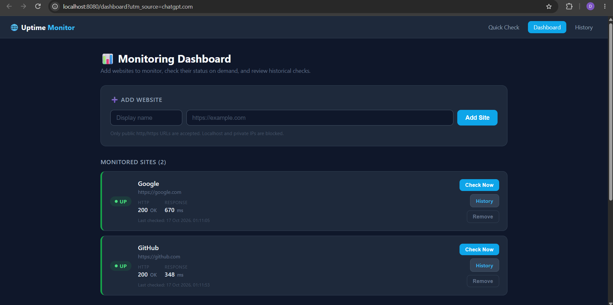
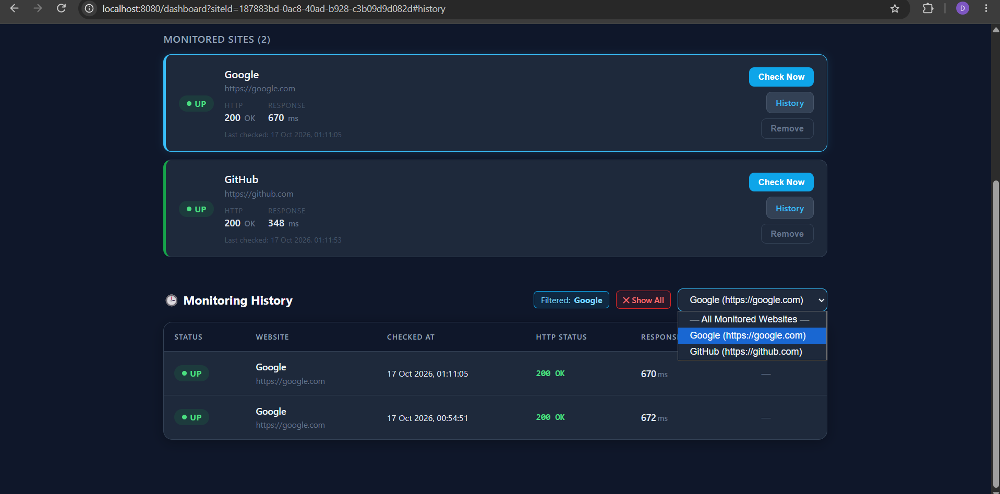

# Website Uptime Monitor

[](https://adoptium.net)
[](https://spring.io/projects/spring-boot)
[](https://www.mysql.com/)
[](https://www.thymeleaf.org/)
[](LICENSE)

A production-grade, full-stack website health and availability monitoring application built with **Java 17**, **Spring Boot 3**, and **MySQL**. The system enables developers, DevOps engineers, and system administrators to track public web services in real time, record round-trip HTTP response latency, inspect detailed HTTP status codes, and maintain an audit history of monitoring checks via an interactive dark-themed web dashboard.

---

## Application Previews

### Multi-Website Monitoring Dashboard


### Chronological Check History & Inspection


---

## Problem Statement

Website downtime, transient network hiccups, and degraded server response times lead directly to lost business revenue, reduced user engagement, and damaged customer trust. Developers and operations engineers need an efficient, dependable way to track service reachability without the overhead, configuration complexity, and cost of enterprise-scale APM platforms.

Simultaneously, building a network monitoring tool introduces a critical security vulnerability: **Server-Side Request Forgery (SSRF)**. If an application blindly accepts URLs and sends outbound HTTP requests on behalf of users, malicious actors can exploit it to probe private subnets (RFC 1918), scan loopback ports (`127.0.0.1`), or access sensitive cloud metadata services.

**Website Uptime Monitor** solves both problems by pairing a multi-site monitoring dashboard with an enterprise-grade SSRF security engine that validates all target hostnames, blocks internal addresses, and re-validates redirect destinations at every hop.

---

## Key Features

- **Ad-Hoc Quick Check**: Instant single-URL availability verification from the home page without saving to the database.
- **Multi-Website Management**: Add, track, and manage multiple websites concurrently with custom display names and URLs.
- **On-Demand Health Checking**: Interactive "Check Now" triggers an immediate HTTP GET check with visual button loading spinners.
- **Live Latency & Status Reporting**: Real-time evaluation of:
  - Health state: `UP` (HTTP 1xx–4xx) or `DOWN` (HTTP 5xx, timeouts, connection failures)
  - HTTP status code (e.g., `200`, `301`, `404`, `503`)
  - HTTP status text (e.g., `OK`, `Moved Permanently`, `Service Unavailable`)
  - Precise round-trip response time measured in milliseconds (`ms`)
- **Persistent Check History**: Every monitoring check is stored in a dedicated MySQL `check_history` table, capturing timestamps, latency, status codes, and exact error messages for diagnostic review.
- **Per-Site History Filtering**: Filter logs by a specific website to analyze performance trends, or inspect all checks across all monitored sites ordered chronologically (newest first).
- **Cascading Deletion Lifecycle**: Removing a website automatically cascades and purges associated historical records via relational database foreign key constraints (`ON DELETE CASCADE`), ensuring database hygiene.
- **Strict SSRF Mitigation**:
  - Rejects `localhost`, `*.localhost`, and `*.local` hostnames.
  - Blocks IPv4 and IPv6 loopback addresses (`127.0.0.1`, `::1`).
  - Blocks private RFC 1918 IP ranges (`10.0.0.0/8`, `172.16.0.0/12`, `192.168.0.0/16`).
  - Blocks link-local subnets (`169.254.0.0/16`, `fe80::/10`) and wildcard addresses (`0.0.0.0`, `::`).
  - **Redirect Re-Validation**: Client redirect traversal is set to `NEVER`; up to 5 redirect hops are followed manually with full security re-validation applied to each target `Location` header before connecting.
- **Modern Dark UI**: Fully responsive, dark-mode web interface styled with vanilla CSS Grid/Flexbox, status indicators, and lightweight JavaScript.

---

## Technology Stack

| Layer | Technology | Details & Purpose |
|---|---|---|
| **Backend Language** | **Java 17 (LTS)** | Core application logic; leverages modern Java features like Text Blocks, Streams, and `java.net.http.HttpClient`. |
| **Framework** | **Spring Boot 3.2.5** | Core framework providing embedded Apache Tomcat 10, dependency injection, and MVC request handling. |
| **Persistence** | **Spring JDBC (`JdbcTemplate`)** | Lightweight, thread-safe data access layer providing transparent SQL queries and entity row mapping without ORM overhead. |
| **Database** | **MySQL 8.0+** | Relational database permanently persisting monitored sites and historical check execution data. |
| **Database Driver** | **MySQL Connector/J 8.x** | Official Type 4 JDBC driver connecting Spring Boot to MySQL. |
| **Template Engine** | **Thymeleaf 3.x** | Server-side template engine rendering responsive HTML5 views. |
| **Frontend** | **HTML5, CSS3, JavaScript** | Pure vanilla frontend; zero external CSS frameworks or heavy JS libraries for optimal rendering performance. |
| **Build Tool** | **Apache Maven 3.8+** | Dependency resolution, test execution, and production JAR compilation. |

---

## System Architecture

The application implements a clean, layered architectural design adhering to Separation of Concerns:

```
                  ┌───────────────────────────────┐
                  │      Web Browser (Client)     │
                  └───────────────┬───────────────┘
                                  │ HTTP (GET / POST)
                                  ▼
 ┌─────────────────────────────────────────────────────────────────┐
 │                       Spring Boot Application                   │
 │                                                                 │
 │   ┌─────────────────────────────────────────────────────────┐   │
 │   │                      Controller Layer                   │   │
 │   │  • UptimeController      (Quick single-check page)       │   │
 │   │  • DashboardController   (Dashboard & history routes)   │   │
 │   └────────────────────────────┬────────────────────────────┘   │
 │                                │                                │
 │       ┌────────────────────────┴────────────────────────┐       │
 │       ▼                                                 ▼       │
 │  ┌─────────────────────────┐             ┌────────────────────┐ │
 │  │      Service Layer      │             │  Repository Layer  │ │
 │  │                         │             │                    │ │
 │  │  • UptimeCheckerService │             │  • SiteRepository  │ │
 │  │    - URL Sanitizer      │             │  • CheckHistoryRepo│ │
 │  │    - SSRF Firewall      │             │    (JdbcTemplate)  │ │
 │  │    - Redirect Inspector │             └─────────┬──────────┘ │
 │  │    - HTTP Client Check  │                       │            │
 │  └─────────────────────────┘                       │            │
 └────────────────────────────────────────────────────┼────────────┘
                                                      │ JDBC / SQL
                                                      ▼
                                       ┌─────────────────────────┐
                                       │     MySQL Database      │
                                       │    (uptime_monitor)     │
                                       │  • monitored_sites      │
                                       │  • check_history        │
                                       └─────────────────────────┘
```

---

## Project Directory Structure

```
WebsiteUptimeMonitor/
├── pom.xml                                      # Maven project dependencies and build plugins
├── README.md                                    # Project documentation
├── .gitignore                                   # Git exclusion rules (targets, logs, IDE files)
├── screenshots/                                 # Application interface screenshots
│   ├── dashboard.png                            # Main dashboard preview
│   └── monitoring-history.png                   # Check history log preview
├── src/
│   └── main/
│       ├── java/
│       │   └── com/
│       │       └── uptimemonitor/
│       │           ├── UptimeMonitorApplication.java    # Spring Boot main entry point
│       │           ├── controller/
│       │           │   ├── DashboardController.java     # Dashboard, site actions, and history routing
│       │           │   └── UptimeController.java        # Single-URL quick-check controller
│       │           ├── model/
│       │           │   ├── CheckHistoryItem.java        # Entity representing a historical check log
│       │           │   ├── CheckResult.java             # Value object encapsulating check outcomes
│       │           │   └── MonitoredSite.java           # Domain model representing a monitored website
│       │           └── service/
│       │               ├── CheckHistoryRepository.java  # JdbcTemplate DAO for check_history table
│       │               ├── SiteRepository.java          # JdbcTemplate DAO for monitored_sites table
│       │               └── UptimeCheckerService.java    # Core validator, SSRF firewall, and HTTP client
│       └── resources/
│           ├── application.properties                   # Datasource configuration and template settings
│           ├── schema.sql                               # Idempotent DDL script executed on startup
│           └── templates/
│               ├── dashboard.html                       # Dashboard, sites grid, and history table
│               └── index.html                           # Home page quick-check interface
└── target/
    └── website-uptime-monitor-1.0.0.jar                 # Production-ready executable JAR
```

---

## How Monitoring Works Under the Hood

### 1. URL Sanitization & Scheme Enforcement
When a user submits a URL, `UptimeCheckerService.validateUrl()` trims whitespace and automatically prepends `https://` if no protocol is specified. It parses the string into a `java.net.URI` and validates that the scheme is strictly `http` or `https`.

### 2. Multi-Layer SSRF Defense & DNS Resolution
Before opening any network socket, the service performs a DNS lookup via `InetAddress.getAllByName(host)`. It inspects every returned address against safety predicates:
- If the hostname equals or ends with `localhost` or `.local`, it is rejected.
- If any resolved address is loopback (`127.0.0.0/8`, `::1`), site-local private (`10.0.0.0/8`, `172.16.0.0/12`, `192.168.0.0/16`), link-local (`169.254.0.0/16`), or wildcard (`0.0.0.0`), a `SecurityException` is thrown immediately.

### 3. HTTP Request Execution & Timing
The service initiates a `GET` request using Java's high-performance `HttpClient`:
```java
long start = System.currentTimeMillis();
HttpResponse<Void> response = client.send(request, HttpResponse.BodyHandlers.discarding());
long elapsed = System.currentTimeMillis() - start;
```
Body bytes are discarded to minimize bandwidth and memory footprint. Connect and read timeouts are set to **10 seconds** to prevent resource exhaustion from hanging connections.

### 4. Safe Redirect Traversal (Up to 5 Hops)
Automatic redirect following is disabled (`Redirect.NEVER`). When an HTTP `301`, `302`, `303`, `307`, or `308` redirect is returned:
1. The service extracts the `Location` header and resolves relative paths against the current URI.
2. The redirect target's hostname is extracted and **passed through the full SSRF validation routine**.
3. If safe, the next request is dispatched. A maximum limit of 5 hops prevents infinite redirect loops.

### 5. Persistent Record Creation
When a check is executed from the dashboard:
1. `CheckResult` is generated with status (`UP`/`DOWN`), HTTP status code, status text, elapsed time, and error details (if any).
2. `CheckHistoryRepository.save(...)` persists a row into `check_history`.
3. The dashboard reloads, displaying the latest result on the website card and inserting the record at the top of the history table.

---

## Database Setup (MySQL)

### Step 1: Create the Database
Open **MySQL Workbench** or your terminal shell and execute:

```sql
CREATE DATABASE IF NOT EXISTS uptime_monitor
    CHARACTER SET utf8mb4
    COLLATE utf8mb4_unicode_ci;
```

### Step 2: Automated Schema Initialization
The application ships with `src/main/resources/schema.sql`. Because `spring.sql.init.mode=always` is enabled, Spring Boot executes this DDL script on startup automatically:

```sql
-- Table storing monitored websites
CREATE TABLE IF NOT EXISTS monitored_sites (
    id           VARCHAR(36)   NOT NULL,
    name         VARCHAR(100)  NOT NULL,
    url          VARCHAR(2048) NOT NULL,
    added_at     DATETIME      NOT NULL,
    PRIMARY KEY (id)
) ENGINE=InnoDB DEFAULT CHARSET=utf8mb4;

-- Table storing chronological check logs
CREATE TABLE IF NOT EXISTS check_history (
    id               BIGINT       NOT NULL AUTO_INCREMENT,
    site_id          VARCHAR(36)  NOT NULL,
    checked_at       DATETIME     NOT NULL,
    status           VARCHAR(10)  NOT NULL,
    http_status_code INT          NOT NULL,
    http_status_text VARCHAR(50)  NOT NULL,
    response_time_ms BIGINT       NOT NULL,
    error_message    TEXT,
    PRIMARY KEY (id),
    CONSTRAINT fk_history_site
        FOREIGN KEY (site_id) REFERENCES monitored_sites(id)
        ON DELETE CASCADE
) ENGINE=InnoDB DEFAULT CHARSET=utf8mb4;
```

---

## Installation & Configuration (Windows)

### Prerequisites

Ensure the following tools are installed on your system:
- **Java JDK 17** or later ([Adoptium Temurin](https://adoptium.net/))
- **Apache Maven 3.8+** ([Maven Downloads](https://maven.apache.org/download.cgi))
- **MySQL Server 8.0+** running on `localhost:3306`

Verify installations:
```powershell
java -version
mvn -version
```

### Environment Variable Configuration

Database credentials are parameterized in `application.properties` to ensure credentials are never committed to version control:

```properties
spring.datasource.url=jdbc:mysql://localhost:3306/uptime_monitor?useSSL=false&serverTimezone=UTC&allowPublicKeyRetrieval=true
spring.datasource.username=${DB_USERNAME}
spring.datasource.password=${DB_PASSWORD}
spring.datasource.driver-class-name=com.mysql.cj.jdbc.Driver
```

Set your credentials in your terminal session before launching the application:

#### In Windows PowerShell:
```powershell
$env:DB_USERNAME="root"
$env:DB_PASSWORD="your_mysql_password"
```

#### In Windows Command Prompt (CMD):
```cmd
set DB_USERNAME=root
set DB_PASSWORD=your_mysql_password
```

---

## How to Build & Run

### 1. Run with Maven (Development Mode)
Navigate to the project root and execute:

```powershell
mvn spring-boot:run
```

Once initialized, the console will display:
```
Started UptimeMonitorApplication in X.XXX seconds
```

### 2. Package and Run Standalone Executable JAR
To produce a self-contained production JAR:

```powershell
# Clean and package
mvn clean package -DskipTests

# Execute the packaged JAR
java -jar target\website-uptime-monitor-1.0.0.jar
```

To stop the running application at any time, press `Ctrl + C`.

---

## Accessing the Application

Open your browser and navigate to:

| Endpoint | Purpose |
|---|---|
| **`http://localhost:8080/dashboard`** | **Main Monitoring Dashboard** — Add websites, trigger checks, manage sites, and inspect historical check logs. |
| **`http://localhost:8080/`** | **Quick Check Home Page** — Single-URL availability and response-time checker. |

---

## Troubleshooting Guide

| Issue | Cause | Resolution |
|---|---|---|
| `CommunicationsException: Communications link failure` | MySQL service is stopped or port `3306` is inaccessible. | Start MySQL from Windows Services (`services.msc` -> MySQL80 -> Start) or verify port `3306`. |
| `Access denied for user 'root'@'localhost'` | Incorrect database credentials provided. | Verify your password and re-export `$env:DB_PASSWORD="correct_password"`. |
| `Unknown database 'uptime_monitor'` | Database was not created prior to application launch. | Open MySQL Workbench and run `CREATE DATABASE uptime_monitor;`. |
| `Port 8080 was already in use` | Another process is occupying port `8080`. | Terminate the occupying process via `Get-Process` or change `server.port=8081` in `application.properties`. |
| `Requests to localhost and .local domains are not allowed` | SSRF defense blocked an internal endpoint. | Intended behavior. Only public `http://` and `https://` URLs are permitted. |

---

## Security Considerations & Current Limitations

### Security Protections
- **SSRF Defense**: Prevents malicious actors from using the server to port-scan internal infrastructure, loopback interfaces, or private subnets.
- **SQL Injection Prevention**: All database queries are executed via Spring's `JdbcTemplate` using parameterized SQL (`?` placeholders).
- **Credential Safety**: No hardcoded passwords in source code; configuration is injected via environment variables.

### Current Limitations
- **Manual Check Triggers**: Checks are triggered on-demand via the web UI; there is currently no background scheduled runner (e.g., cron or `@Scheduled`).
- **Single-Tenant Scope**: Designed as an internal administrative tool without multi-user accounts, authentication sessions, or tenant isolation.
- **Alerting Notifications**: Does not currently dispatch external notifications (email, SMS, Webhooks, Discord, or Slack) when a service transitions to `DOWN`.
- **HTTP Methods**: Restricted to HTTP `GET`; does not support custom request bodies (e.g., `POST`), header injection, or SSL certificate expiry checks.

---

## Future Enhancements

The following roadmap items represent planned future evolutions:

1. **Automated Background Polling**: Integration of Spring `@Scheduled` tasks to poll monitored websites at configurable intervals (e.g., every 1, 5, or 15 minutes).
2. **Alerting Integrations**: Dispatch instant incident notifications via Webhooks (Slack/Discord) and SMTP email alerts upon outage detection.
3. **Uptime Percentage Analytics**: Calculation of 24-hour, 7-day, and 30-day uptime percentage metrics based on `check_history` records.
4. **Interactive Response Latency Charts**: Visual response-time trend graphs using Chart.js or ApexCharts.
5. **User Authentication & Role-Based Access**: Multi-user accounts with Spring Security to support personal dashboards.

---

## Conclusion

**Website Uptime Monitor** demonstrates practical, end-to-end full-stack software engineering principles: building clean layered architectures, implementing enterprise-grade network security against SSRF vulnerabilities, executing performant HTTP operations with Java's modern network client, and persisting structured data via Spring JDBC and MySQL. It serves as a solid foundation for distributed systems health checking and reliable web operations.
